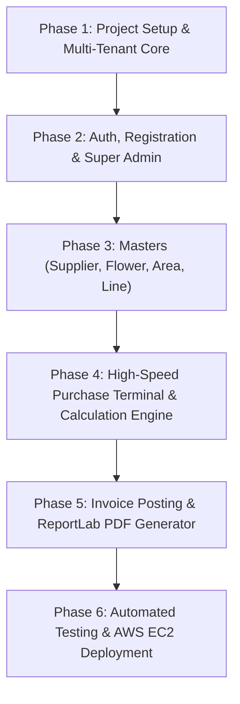

# AVT FLOWER MERCHANT — MASTER IMPLEMENTATION PLAN & TECH STACK
**Architecture:** Django 6.1 Modular Monolith with Multi-Tenant Row-Level Isolation
**Designed for:** High-Speed Flower Commission Accounting & Multi-Shop SaaS

---

## 1. Locked Technology Stack

| Layer | Component | Choice & Specification | Rationale |
|---|---|---|---|
| **Language** | Core Runtime | Python 3.12+ (Current: Python 3.15.2 installed) | High numerical precision with native `Decimal` module |
| **Backend Framework** | Web Core | Django 6.1 (Installed) | Monolithic, battle-tested, secure session authentication, ORM |
| **Database** | RDBMS | PostgreSQL 16+ (Prod) / SQLite (Local Dev) | ACID-compliant transaction safety for financial ledgers |
| **Frontend UI** | Client Interface | HTML5 + CSS3 + Bootstrap 5.3 + Vanilla JS | Zero-latency browser execution, zero Node.js build dependencies |
| **Styling & Themes** | Design System | Cyber-Botanical Glassmorphism (Dual Theme: Dark & Light) | High-speed desktop density with instant theme toggle |
| **PDF Engine** | Document Generation | ReportLab 5.1 (Installed) | Exact millimetre positioning matching Koyambedu physical bills |
| **Deployment** | Server Stack | AWS EC2 (Ubuntu 24.04 LTS), Nginx, Gunicorn, Systemd, Certbot SSL | Enterprise-grade stability, horizontal isolation, low operational cost |

---

## 2. Django Modular Application Architecture

```
avt_flower_management/
├── config/                  # Core Project Configuration
│   ├── settings/
│   │   ├── base.py          # Shared settings, apps, middleware
│   │   ├── local.py         # Local development settings (SQLite/debug)
│   │   └── production.py    # Production settings (PostgreSQL, SSL, security)
│   ├── asgi.py
│   ├── wsgi.py
│   └── urls.py              # Root routing
├── apps/
│   ├── core/                # Tenant isolation base models & utilities
│   │   ├── models.py        # ShopAwareModel, TimestampedModel
│   │   └── managers.py      # ShopManager (auto-scoping querysets)
│   ├── accounts/            # Authentication & Super Admin System
│   │   ├── models.py        # Custom User, RegistrationRequest, AuditLog
│   │   ├── views.py         # Login, Register, Pending screen, Admin Portal
│   │   └── backends.py      # Multi-tenant auth backend with status check
│   ├── shops/               # Multi-Shop Tenant Profiles & Settings
│   │   ├── models.py        # Shop profile (motto, market address, phone)
│   │   └── views.py         # Company setup, station settings
│   ├── parties/             # Suppliers, Farmers & Area Masters
│   │   ├── models.py        # Supplier, Area, Line, LedgerGroup
│   │   └── views.py         # Supplier Master CRUD, autocomplete API
│   ├── flowers/             # Floral Catalog & Varieties
│   │   ├── models.py        # Flower variety, units, default rate
│   │   └── views.py         # Flower catalog endpoints
│   ├── purchases/           # Core Purchase Entry & Transaction Engine
│   │   ├── models.py        # PurchaseLot, PurchaseLotItem, PurchasePosting
│   │   ├── services.py      # CalculationEngine (Exact Decimal formulas)
│   │   └── views.py         # High-speed terminal entry, posting dialog
│   └── reports/             # Billing, Accounting & PDF Generation
│       ├── services.py      # ReportLab PDF invoice generator
│       └── views.py         # Invoice viewer, PDF download handler
├── static/                  # CSS, JS, Branding Assets
├── templates/               # Django HTML Templates (Dual-theme components)
├── tests/                   # Automated Financial & Security Test Suites
├── deploy/                  # Nginx configs, Gunicorn service scripts, backup cron
├── manage.py
└── requirements.txt
```

---

## 3. Multi-Tenant Security & Data Isolation Architecture

To ensure **Shop A cannot access Shop B's records under any circumstance**:
1. **Base Tenant Model (`ShopAwareModel`):**
   ```python
   class ShopAwareModel(models.Model):
       shop = models.ForeignKey('shops.Shop', on_delete=models.CASCADE, related_name="%(class)ss")
       objects = ShopManager()
       all_objects = models.Manager()

       class Meta:
           abstract = True
   ```
2. **Automatic Query Scoping (`ShopManager`):**
   - Every database query automatically filters by the currently logged-in user's `shop_id`.
   - Normal shop owners cannot supply a custom `shop_id` to override permissions.
3. **Super Admin Access Guard:**
   - Super Admin accounts bypass tenant scoping to manage platform shops, review pending requests, and view audit logs.

---

## 4. Phase-by-Phase Implementation Roadmap



### Detailed Phase Milestones:
- **Phase 1 · Django Monolith & Multi-Tenant Core:**
  - Initialize clean project directory structure.
  - Implement `ShopAwareModel`, `ShopManager`, and base abstract models with UUID keys.
  - Configure dual-theme static pipeline.
- **Phase 2 · Auth Lifecycle & Super Admin Portal:**
  - Custom User model with email/username dual login.
  - Shop registration form with `PENDING` state machine.
  - Pending approval block screen with configurable `ADMIN_CONTACT_NUMBER`.
  - Super Admin Dashboard with KPI counters and 1-click Approve/Reject actions.
- **Phase 3 · Operational Masters (Supplier, Flower, Area, Line):**
  - Supplier / Party Master with all 11 verified fields and `[Add]` / `[Directory]` tabs.
  - Flower catalog with rapid code lookup (`DOLY` -> `DOL YELLOW`).
  - Area and Line transport route management.
- **Phase 4 · High-Speed Purchase Terminal:**
  - 11-column transactional grid matching desktop speed.
  - Real-time `Decimal` calculations (Row Value, Luggage, Coolie, Nett).
  - Floating action bar and luminous Net Balance HUD.
- **Phase 5 · Purchase Posting & ReportLab PDF Engine:**
  - Cutoff date selection (`From Date` and `To Date`).
  - Advance deduction input.
  - Pixel-perfect ReportLab PDF generation matching Koyambedu physical bill format.
- **Phase 6 · Verification & AWS EC2 Deployment:**
  - Financial verification test suite (matching sample bills down to the exact rupee).
  - Multi-tenant security penetration tests.
  - Nginx, Gunicorn, PostgreSQL, and SSL configuration scripts.
