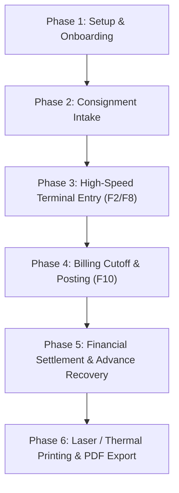

# AVT – FLOWER MERCHANT & COMMISSION AGENT
## Comprehensive Project Workflow & Production Business Logic Architecture

---

### 1. Executive System Overview
**AVT – FLOWER MERCHANT & COMMISSION AGENT** is a specialized, web-based commercial management system recreating the proven workflow of **Ability Software** (used by leading commission agents in Kamarajar Wholesale Flower Market, Koyambedu, Chennai-92).

Unlike generic retail software, flower commission merchants operate on an **agency consignment model**:
- **Suppliers (Farmers / Mandi Consignors):** Send consignments of cut flowers (e.g., Dol Yellow, Paneer, Button Samanthi, Mirabel) via buses/lorries from procurement belts like Salem, Hosur, Anekal, and Mayachandra.
- **Commission Agent (Merchant):** Receives the lots, weighs them, auctions/sells them at daily market rates, deducts predetermined expenses (Commission %, Luggage freight per box, Coolie handling, and Cash Advance recoveries), and remits the Net Balance Payable to the supplier.

---

### 2. End-to-End Daily Project Workflow

#### Phase 1: Supplier & Flower Master Setup (Pre-Market)
1. **Supplier Registration (11 Verified Fields):**
   - Supplier Code (e.g., `HMS DPS`, `SHM PANEER`)
   - Full Supplier Name & Procurement Belt (`SALEM`, `MAYACHANDRA`)
   - Ledger Group (`Suppliers Group / Sundry Creditors`)
   - Individual Commission Percentage (e.g., `15.00%` for HMS, `10.00%` for SHM)
   - Default Luggage Freight Rate (e.g., `₹ 150.00` per box)
   - Prior Opening Cash Advance Balance
   - Gate Charges applicability & Interest %
2. **Flower Catalog Configuration:**
   - Variety Code (e.g., `DOLY`, `PAN`, `SAM`)
   - Variety Name (`DOL YELLOW`, `PANEER ROSE`)
   - Daily Market Default Rate per kg (`₹ 40.00`, `₹ 50.00`)

---

#### Phase 2: Morning Lot Arrival & Intake
- Consignments arrive at the Koyambedu mandi between 2:00 AM and 6:00 AM.
- Freight carriers unload boxes with supplier marking slips (`HMS DPS`, etc.).
- Station clerk enters the trading floor and opens the **AVT Trading Terminal** (`http://127.0.0.1:8002/`).

---

#### Phase 3: High-Speed Terminal Lot Entry
1. **Selecting the Party:**
   - Clerk types Party Code `HMS DPS` or selects from the dropdown.
   - The system instantly loads:
     - Supplier's specific Commission % (e.g. 15.0%)
     - Procurement belt (Salem)
     - Default luggage rate (₹ 150/box)
     - Any unposted open lots for that date.
2. **Rapid Row Entry (F2 Shortcut & Keyboard Navigation):**
   - **Flower Code:** Type `DOLY` -> Auto-resolves `DOL YELLOW` and default rate `₹ 40.00`.
   - **Weight:** Type `300.000` kg.
   - **Rate:** Auto-filled `40.00` (modifiable).
   - **Gross Calculation:** System calculates `Gross = 300.000 × 40.00 = ₹ 12,000.00`.
   - **Boxes:** Type `20`.
   - **Luggage:** System calculates `20 × 150.00 = ₹ 3,000.00`.
   - **Coolie:** System calculates `20 × 15.00 = ₹ 300.00`.
   - **Net Lot Value:** System calculates `₹ 12,000.00 - (₹ 3,000.00 + ₹ 300.00) = ₹ 8,700.00`.
3. **Live HUD Settlement Monitor:**
   - Real-time aggregation across all active rows:
     - Gross Value: `₹ 24,000.00`
     - Total Less: `₹ 10,200.00`
     - Net Balance Payable: `₹ 13,800.00`
4. **Batch Persistence (F8 Shortcut):**
   - Clerk presses **F8** or clicks **Save Lots**.
   - System commits the lots into the database with unique `lot_id` and timestamp.

---

#### Phase 4: Purchase Posting Cutoff Cycle (F10 Shortcut)
Commission merchants don't settle lot-by-lot; they settle weekly or bi-weekly cycles called a **"Cutoff Posting"**:
1. Clerk presses **F10** to open the **Purchase Posting & Bill Cutoff Modal**.
2. **Posting Sequence Number:** System allocates the next sequential number (e.g. `0032`, `0033`).
3. **Date Cutoff:** Sets `From Date` (e.g. `2026-11-01`) and `To Date` (e.g. `2026-11-03`).
4. **Advance Recovery Entry:** Clerk enters advance amount to recover against this cycle (e.g., `₹ 2,000.00`).
5. **Sealing the Lots:**
   - The system seals all matching unposted lots with the assigned `posting_no`.
   - The lots are archived from open trading so they can never be billed twice.

---

#### Phase 5: Financial Statement Reconciliation
- The system generates the **Koyambedu Bill** (`/invoice/`):
  - Lists each lot date, flower variety, weight, rate, boxes, luggage, coolie, and gross value.
  - Itemized deductions breakdown:
    - **Commission:** $\text{Gross} \times (\text{Supplier Comm \%} / 100)$
    - **Total Luggage:** Sum of all freight incurred across lots.
    - **Coolie:** Sum of all handling charges.
    - **Advance Recovered:** Current bill deduction.
    - **Total Less:** Total sum of all deductions.
    - **Net Balance Payable:** Final cash/bank amount due to the farmer.

---

#### Phase 6: Thermal / Laser Printing & PDF Dispatch
1. **Direct Print:** One click prints thermal mandi slip or A4 statement with devotional header:
   `ARULMIGU VINAYAGA THUNAI · ARULMIGU VEERUCHINNAMMAL THUNAI`
2. **ReportLab PDF Export:** Streams official high-resolution PDF matching the physical bill, ready for WhatsApp dispatch to the farmer.

---

### 3. Multi-Tenant Shop Governance
1. **Online Shop Registration (`/register/`):**
   - New agencies apply online with Shop Name, Mandi Address, Owner Username, Mobile, and Email.
   - Status defaults to `PENDING`.
2. **Security Gate (`/pending/`):**
   - Prevents unapproved login.
   - Displays configurable administrator contact number (`ADMIN_CONTACT_NUMBER = 9080188707`).
3. **Super Admin Management (`/super-admin/`):**
   - Super Admin reviews pending applications.
   - One-click `Approve`, `Reject`, or `Deactivate`.
   - Data is isolated by `shop_id` across all tables.

---

### 4. Database Architecture (Google Sheets + Resilient Mirror)
- **Worksheets:**
  1. `Shops`: Tenant profiles, credentials, approval states.
  2. `Suppliers`: Supplier accounting profiles, commission %, and balances.
  3. `Flowers`: Variety names and market reference rates.
  4. `Purchases`: Every individual purchase lot with financial attributes.
  5. `Postings`: Historical cutoff statements with advance deductions.
- **Sync Mechanism:**
  - Connected: Live API writes to Google Drive via `gspread`.
  - Offline: Local JSON mirror (`data/gsheet_local_mirror.json`) ensures 100% station uptime during internet interruptions.
